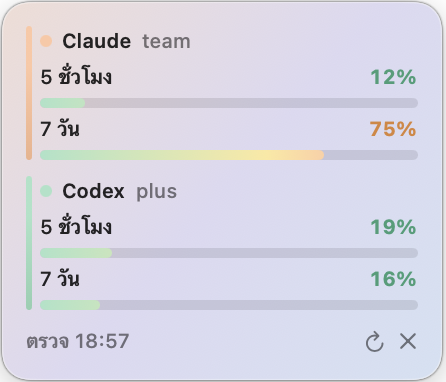
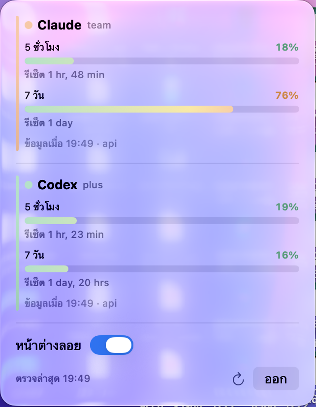

# RxWidget

แอป menu bar, หน้าต่างลอย และ widget บน desktop ของ macOS สำหรับดูโควตาการใช้งาน Claude และ Codex ในที่เดียว

> สถานะ: **กำลังพัฒนา** (เวอร์ชัน 0.1.0) — ยังไม่มี release · รองรับ macOS อย่างเดียว (ฝั่ง iPhone พักไว้ ดู [`docs/spike-ios.md`](docs/spike-ios.md))

<table align="center">
  <tr>
    <td align="center" valign="top">
      <br>
      <sub>หน้าต่างลอย</sub>
    </td>
    <td align="center" valign="top">
      <br>
      <sub>เมนูบน menu bar</sub>
    </td>
  </tr>
</table>

## ฟีเจอร์

- **เมนูบน menu bar** (ไอคอนเกจ) แสดง % โควตาของแต่ละ provider, เวลาที่ตรวจล่าสุด, ปุ่ม refresh และสวิตช์ "หน้าต่างลอย"
- **หน้าต่างลอย** แสดงโควตาชุดเดียวกับเมนู
  - ลอยเหนือทุกแอป ไม่แย่ง focus อยู่ทุก Space และทับแอปเต็มจอได้
  - ลากย้ายได้และจำตำแหน่ง, จำสถานะเปิด/ปิด (เปิดแอปครั้งแรกจะแสดงเลย)
  - ปุ่ม refresh / ซ่อน โผล่เมื่อเอาเมาส์ไปชี้
- **widget บน desktop** ขนาดเล็กและกลาง (`systemSmall`, `systemMedium`)
- ดึงข้อมูลอัตโนมัติทุก 5 นาที ถ้ารอบไหนดึงไม่ได้จะคงค่าเดิมพร้อมป้าย "ข้อมูลเก่า"
- ธีมสีโทนพาสเทล (`Shared/Theme.swift`) ใช้ร่วมกันทั้งเมนู หน้าต่างลอย และ widget
  - สีประจำ provider: Claude พีช, Codex มิ้นต์ (สีของแอปเอง ไม่ใช่สีแบรนด์)
  - แถบ % ไล่สีมิ้นต์ → เหลืองนม → พีช → ชมพูคอรัล, ตัวเลข % เปลี่ยนสีที่ 70% และ 90%
  - พื้นหลังการ์ดไล่สีพีช → ลาเวนเดอร์ → ฟ้าแบบโปร่ง ใช้ได้ทั้งโหมดสว่างและมืด

## Provider ที่รองรับ

| Provider | แหล่งข้อมูล | สิ่งที่แสดง | สถานะ |
|---|---|---|---|
| Claude (subscription) | `GET api.anthropic.com/api/oauth/usage` ด้วย token ของ Claude Code | % ช่วง 5 ชั่วโมง, 7 วัน, 7 วันรายรุ่น | ✅ data layer |
| Codex (ChatGPT plan) | `GET chatgpt.com/backend-api/wham/usage` → fallback log `~/.codex/sessions` | % ช่วง 5 ชั่วโมง, 7 วัน | ✅ data layer |
| Claude API | Admin API `/v1/organizations/cost_report` | ยอดใช้จ่ายเดือนนี้ | ⏳ ยังไม่เริ่ม |
| OpenAI API | Costs API `/v1/organization/costs` | ยอดใช้จ่ายเดือนนี้ (ไม่มี API ยอดคงเหลือ) | ⏳ ยังไม่เริ่ม |

endpoint ของ Claude subscription และ Codex **ไม่ได้ประกาศเป็นทางการ** อาจเปลี่ยนหรือใช้ไม่ได้เมื่อไรก็ได้
แอปจึงแปลงทุกความผิดพลาดเป็นสถานะบนหน้าจอ และคงค่าล่าสุดไว้พร้อมป้าย "ข้อมูลเก่า"

## สถาปัตยกรรม

```
┌─────────────────────────────────┐    App Group container    ┌──────────────────────┐
│ RxWidget (host app, ไม่ sandbox) │ ──► <TEAMID>.rxwidget/ ──► │ RxWidgetExtension    │
│ • menu bar + หน้าต่างลอย          │    usage-snapshot.json     │ (widget, sandbox)    │
│ • อ่าน Keychain / ~/.codex        │                           │ • อ่านอย่างเดียว        │
│ • เรียก API ทุก 5 นาที             │                           └──────────────────────┘
│ • เขียน snapshot + reload widget  │
└─────────────────────────────────┘
```

- **host app** ดึงข้อมูลทั้งหมด แล้วเขียน `UsageSnapshot` เป็น JSON ลง App Group
  เมนูและหน้าต่างลอยอ่านข้อมูลจาก `UsageCoordinator` ตัวเดียวกันในหน่วยความจำ
- **widget** อ่าน snapshot ไปแสดงอย่างเดียว ไม่เรียกเครือข่ายและไม่แตะ credential
- ช่วงเวลาของโควตาแยกตาม**ความยาว window** (5 ชั่วโมง / 7 วัน) ไม่ยึดชื่อ slot ของ provider

## ความปลอดภัยของ credential

- **อ่านอย่างเดียว** ไม่ refresh token ของ Claude Code หรือ Codex เอง
  ถ้า token หมดอายุ แอปจะแสดง "ข้อมูลเก่า" จนกว่าจะเปิด Claude Code / Codex ให้ต่ออายุเอง
- token ของ Claude Code อ่านจาก Keychain item `Claude Code-credentials` ผ่าน `/usr/bin/security`
- token ของ Codex อ่านจาก `~/.codex/auth.json`
- Admin key ของ Claude API / OpenAI API (เมื่อทำเสร็จ) จะเก็บใน Keychain ของ RxWidget เอง
- token ไม่ถูกเขียนลง App Group หรือ log

## ไฟล์ที่ไม่ถูก commit

ไฟล์เหล่านี้อยู่ใน `.gitignore` ต้องสร้างเองบนเครื่องหลัง clone

| ไฟล์ | วิธีสร้าง |
|---|---|
| `Config/Signing.xcconfig` | คัดลอกจาก `Config/Signing.xcconfig.example` แล้วใส่ Team ID ของตัวเอง |
| `RxWidget.xcodeproj/` | รัน `xcodegen` (สร้างจาก `project.yml`) |

นอกจากนี้ `.gitignore` กันไฟล์ secret ไว้ด้วย (`.env`, `*.p12`, provisioning profile, `auth.json`, `usage-snapshot.json`) — ห้ามบังคับ add ด้วย `git add -f`

## ความต้องการของระบบ

- macOS 26 Tahoe ขึ้นไป
- Xcode 26 ขึ้นไป
- [XcodeGen](https://github.com/yonaskolb/XcodeGen) (`brew install xcodegen`)
- Apple ID ที่ login ใน Xcode (Personal Team ฟรีก็พอ)
- ใช้กับ Claude: login Claude Code ด้วยบัญชี claude.ai (`claude auth login`)
- ใช้กับ Codex: login Codex CLI ด้วยบัญชี ChatGPT

## Build และรัน

1. คัดลอกไฟล์ตัวอย่าง แล้วใส่ Team ID ของตัวเองใน `Config/Signing.xcconfig`
   (ไฟล์นี้อยู่ใน `.gitignore` ไม่ถูก commit)

   ```bash
   cp Config/Signing.xcconfig.example Config/Signing.xcconfig
   ```

   ```
   DEVELOPMENT_TEAM = XXXXXXXXXX
   ```

   หา Team ID ได้จากใบรับรอง Apple Development (ดูค่า `OU=`):

   ```bash
   security find-certificate -c "Apple Development" -p | openssl x509 -noout -subject
   ```

2. สร้าง Xcode project แล้วเปิด

   ```bash
   xcodegen
   open RxWidget.xcodeproj
   ```

   ไม่ต้อง commit `RxWidget.xcodeproj` — สร้างใหม่จาก `project.yml` ได้ทุกเมื่อ
   แก้ setting ใน `project.yml` / `Config/*.xcconfig` แทนการแก้ใน Xcode (ค่าที่แก้ใน Xcode จะหายเมื่อรัน `xcodegen`)

3. เลือก scheme `RxWidget` แล้ว Run (⌘R) — ไอคอนเกจจะขึ้นบน menu bar และหน้าต่างลอยจะแสดงขึ้นมา
4. เพิ่ม widget: คลิกขวาที่ desktop → Edit Widgets → ค้นหา "RxWidget"
5. ปิด/เปิดหน้าต่างลอยได้จากสวิตช์ "หน้าต่างลอย" ในเมนู

## โครงสร้างโปรเจกต์

```
project.yml                 XcodeGen spec (2 target)
Config/Signing.xcconfig.example  ตัวอย่าง Team ID, bundle prefix, App Group (คัดลอกเป็น Signing.xcconfig)
App/                        host app (menu bar)
  RxWidgetApp.swift         MenuBarExtra + หน้า panel ในเมนู
  FloatingPanel.swift       หน้าต่างลอย (NSPanel) + จำตำแหน่ง/สถานะ
  UsageCoordinator.swift    รอบดึงข้อมูล, merge ข้อมูลเก่า, เขียน snapshot
  Providers/                provider แต่ละเจ้า + HTTP/process/date helpers
Widget/                     widget extension
Shared/                     ใช้ร่วมกันทั้ง 2 target
  UsageModels.swift         UsageSnapshot / ProviderSnapshot / UsageWindow
  SnapshotStore.swift       อ่าน/เขียน JSON ใน App Group
  UsageViews.swift          view ที่ใช้ร่วมกัน (เมนู, หน้าต่างลอย, widget)
  Theme.swift               สีพาสเทล, gradient แถบ %, พื้นหลังการ์ด
scripts/probe_providers.py  ตรวจ credential และ endpoint บนเครื่องจริง (ไม่พิมพ์ secret)
docs/                       ผล spike, research และภาพหน้าจอ (img.png, img2.png)
```

## แก้ปัญหา

| อาการ | สาเหตุที่เป็นไปได้ / วิธีแก้ |
|---|---|
| Claude: "ยังไม่ได้ login (token ว่าง)" | Claude Code ไม่ได้ login — รัน `claude auth login` แล้วเช็ก `/status` ใน `claude` |
| Claude: "ข้อมูลเก่า · token หมดอายุ" | token ของ Claude Code อายุ ~8 ชั่วโมง เปิด `claude` สักครั้งเพื่อให้ต่ออายุ |
| Codex: หมายเหตุ "ใช้ข้อมูลจาก log" | `wham/usage` ใช้ไม่ได้ ตัวเลขมาจาก session ล่าสุดของ Codex อาจไม่เป็นปัจจุบัน |
| xcodegen / build: หา `Signing.xcconfig` ไม่เจอ | ยังไม่ได้คัดลอกจาก `Config/Signing.xcconfig.example` |
| widget: "เปิด App Group container ไม่ได้" | `DEVELOPMENT_TEAM` ไม่ตรงกับใบรับรอง หรือยังไม่ได้รัน `xcodegen` ใหม่หลังแก้ |
| widget: "ยังไม่มีข้อมูล" | เปิดแอป RxWidget บน menu bar อย่างน้อยหนึ่งครั้ง |
| widget ยังเป็นหน้าทดสอบ spike | widget kind เปลี่ยนเป็น `UsageWidget` แล้ว — ลบ widget เดิมออกจาก desktop แล้วเพิ่มใหม่ |
| หน้าต่างลอยหายไป | เปิดสวิตช์ "หน้าต่างลอย" ในเมนูบน menu bar |

ตรวจ credential และ endpoint จาก Terminal ได้ด้วย:

```bash
python3 scripts/probe_providers.py
```

## เอกสารเพิ่มเติม

- [`docs/spike-app-group.md`](docs/spike-app-group.md) — ผลทดสอบ App Group + widget กับ Personal Team
- [`docs/spike-ios.md`](docs/spike-ios.md) — ผล spike แอป + widget บน iPhone (พักไว้)
- [`docs/research-providers.md`](docs/research-providers.md) — รูปแบบ credential และ response จริงของแต่ละ provider
- [`changelog.md`](changelog.md) — บันทึกการเปลี่ยนแปลง

## License

[MIT](LICENSE) © 2026 rx8s

## แนวทางพัฒนา

- บันทึกทุกการเปลี่ยนแปลงใน `changelog.md` (Keep a Changelog ภาษาไทย, วันที่ YYYY-MM-DD)
- สีทั้งหมดอยู่ใน `Shared/Theme.swift` — แก้ที่เดียว มีผลทั้งเมนู หน้าต่างลอย และ widget
- ทำงานบน branch `master`
- ค่าที่ผูกกับเครื่องหรือบัญชี (Team ID ฯลฯ) ให้ใส่ใน `Config/Signing.xcconfig` ที่ไม่ถูก commit ถ้าเพิ่ม key ใหม่ ให้เพิ่มใน `Signing.xcconfig.example` ด้วย
